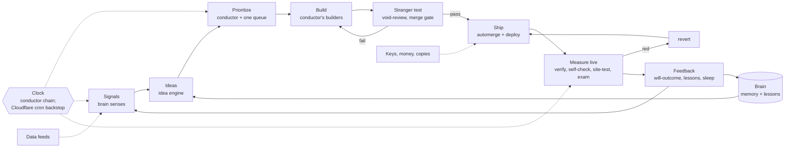

# Verse's system of systems

Written 2026-11-20 from main at `88c802d`, with the loop census read live that evening (`node tools/loop-census.mjs`, 112 workflows, the
newest 30 runs of each). This is the one architecture every loop, idea maker, judge and clock fits into. The map in code is
`void-live-deploy/lib/systems.js` (every workflow placed in exactly one stage; `tools/systems.test.mjs` fails a workflow with no place), and
the owner sees it live, joined with the census, on /progress/ under **How Verse runs** (owner only, from `GET /api/loops`).

## The flow

One loop, eight stages, one owner per stage. Everything else in a stage feeds its owner or does its work; nothing outside the owner decides
for that stage.

| Stage | The one owner | Its job | Loops in it today |
| --- | --- | --- | --- |
| Signals | the brain's senses (`docs/brain.md`) | what people ask and miss, what rivals offer, what the live site and the world show | 16 |
| Ideas | the idea engine (the will, `functions/api/will.js`) | turn signals and Verse's own wants into candidate jobs, after checking what Verse already has | 12 |
| Prioritize | the conductor (`tools/conductor-core.mjs`) | one queue (`/api/queue`), ranked; the most valuable job goes to each idle builder | 1 |
| Build | the conductor's builders | make the change on a branch and open a pull request | 20 |
| Stranger test | `void-review`, then the merge gate | nothing merges that a stranger would find broken, ugly, worse than the best rival, or untrue | 10 |
| Ship | automerge (`tools/automerge.mjs`) and `deploy.yml` | merge what passed and put it live | 8 |
| Measure live | the checks after each deploy | check the live site the way a visitor uses it; red reverts | 32 |
| Feedback | the brain's lessons (`will-outcome`, the nightly sleep) | settle each job by its measured result and keep the lesson for the next idea | 1 |

Beside the flow: **Clock** (the conductor's chain, `grow-clock.yml`, plus `void-tick.yml`), **Data feeds** (6 snapshots that keep cards
current) and **Keys, money and copies** (5: treasury, reinvest, key keeper, mirror, token scopes).

Rules of the flow:
1. **One queue.** Every idea maker writes candidate jobs to the build queue (`/api/queue`); none starts a build itself. The conductor is the
   only thing that picks what is built next.
2. **One gate.** Every change, whoever made it, passes the stranger test before it merges. A check that is not part of the gate is
   information, not a second gate.
3. **Measure once, after deploy.** Each live check runs after a deploy or on the clock, not both, and the full suite runs once per head of
   main (`verify.yml`), not again on a timer.
4. **Every job settles.** A job closes on its measured number (`will-outcome`), and the lesson goes to the brain, which the idea engine
   reads before it proposes the next job.
5. **One clock.** The conductor's chain starts what is due. GitHub's cron lines stay only as the backup.

## The before map (2026-11-20)

- **112 workflows**: 79 working, 4 failing (`watchdog` 13 failures in a row, `suite-gate` 19, `exam` and `verify` red on their last runs),
  8 behind their schedule (`pages-guard`, `recruit`, `arb-record`, `growth-fold`, `verse-watch`, `bot-factory`, `brain-dream`,
  `modal-sing`), 10 idle or never run, 7 the census could not read. 778 runs and about 3,944 runner minutes in 24 hours, $0 (public repo).
- **GitHub's scheduler is the weak link.** Daily crons started a median of 6 to 9 hours late; `*/15` loops fired 21 of 96 times. What
  runs on time is what the conductor starts by dispatch: its own chain ran 30 of the last 30 ticks within about 8 minutes of due.
- **12 idea makers**, each choosing work its own way: the will, brain dreams, the bot factory, recruit, the house lanes (11 crons), learn,
  Verse's voice, probe asks, review-main, grow-self, the dispatcher, the forethinkers; plus the frontier list, the growth inbox, the Tower
  target picker and the new-game loop inside the conductor and the Verse loop.
- **10 judges before merge and 32 live checks after.**

### Duplicates
| What | The copies | Decision |
| --- | --- | --- |
| The full browser suite on main | `verify.yml` on every head, and `watchdog.yml` again in 8 shards daily and every 3 hours while red | The watchdog reads verify's verdict and keeps the issue; it no longer runs the suite (helper/watchdog-reads-verify) |
| The everyday benchmark | `bench.yml` daily, and `watchdog.yml` again on Sundays | `bench.yml` alone |
| Red main | `verify.yml` reverts and records the incident, `watchdog.yml` opens an issue and starts `pr-fix`, the conductor queues a heal job | verify reverts; the conductor heals; the watchdog only keeps the issue open or closed |
| Workflow drafts | `docs/bot-factory.workflow.yml` and `docs/autosalvage.workflow.yml` beside the live files, already different from them | the live file is the only copy; the drafts go to `archive/` |
| Old film loops | `clips.yml` and `record.yml`, both replaced by `shorts.yml` | archived |
| Idea makers | the 12 above | merged by the idea engine into one candidate list feeding the one queue (that work plugs in at the Ideas stage) |
| Clocks | the conductor chain, `void-tick.yml`, recruit's 5 crons, house loops' 11, `team-gate` and `arb-record` every 30 minutes, `pages-guard` every 15 | the conductor's chain (its catch-up list grows to every safe loop); the Cloudflare cron below is the backstop |
| Gates that test a PR merged with main | `merge-gate.yml` and `suite-gate.yml` (hand-run only, 19 red in a row) | one merge gate (stranger-test gate work) |

### Dead
`assemble-growth.yml` (pushes from a one-off branch of 2026-10-03, never ran), `clef-probe.yml` and `route-bench.yml` (one-off probes,
not run in over a month), `clips.yml` and `record.yml` (replaced). Archived to `archive/workflows/` and listed in `docs/SALVAGE.md`, not
deleted. Idle but kept for hand runs: `appraise-live`, `films-live`, `model-bench`, `ouroboros`, `rehearsal`, `think-tank`.

### Gaps
- **Feedback has one loop.** Only `will-outcome` settles a job; most builders' results never reach the brain as a lesson. The brain work
  (lessons from every outcome) is where this closes.
- **Prioritize does not see every idea maker.** Several makers still start their own builds (house lanes, bot factory, store gap). They
  move to writing queue jobs as the idea engine merges them.
- **No clock outside GitHub.** If the conductor's chain breaks, only GitHub's late cron restarts it.

### Conflicts
- Three responders to a red main can race (a revert, a `pr-fix` run and a heal job on the same commit).
- Loops on their own crons compete with the conductor's dispatches for the same runners.

## The clock

- **Now: the conductor's chain.** A tick ends by dispatching the next tick, so it does not wait on GitHub's cron queue. It starts the
  builders, the catch-up list (`tools/catchup-core.mjs`) and `void-tick.yml`. A loop moves onto its clock by joining the catch-up list.
- **Next: a Cloudflare cron Worker as the backstop** (`clock-worker/`). Every 10 minutes it reads the conductor's last tick from the
  `conductor-state` branch and, only when the tick is older than 30 minutes, dispatches `grow-clock.yml`; it also knocks
  `/api/automations/tick`, which retires `void-tick.yml`. Cost: $0 (Workers Free includes 5 cron triggers per account and 100,000
  requests a day; this uses 1 trigger and about 300 requests a day). It needs two secrets the repo does not hold yet:
  `CLOUDFLARE_WORKERS_TOKEN` (Workers Scripts: Edit, already expected by `deploy-workers.yml`) and `CLOCK_GITHUB_TOKEN` (a fine-grained
  token for this repo with Actions: read and write only). Until both exist the Worker is not deployed and nothing changes.
- **Stays on Actions:** everything that builds, tests or deploys (runners, browsers, git). The Worker only knocks.
- **Costs:** Actions minutes are $0 on this public repo; the census logs them per loop. A paid model call is logged by the treasury
  (`lib/treasury.js`); the clock adds no paid call.

## Who works on what
The overall architecture and this map: this document. Plugged in at their stages: the idea engine (Ideas), the stranger-test gate
(Stranger test), automerge (Ship), the brain (Signals and Feedback), automation and the census (Clock and Measure live).
